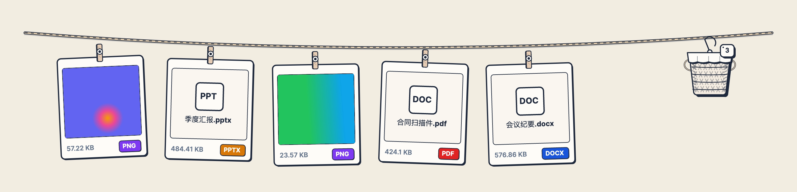
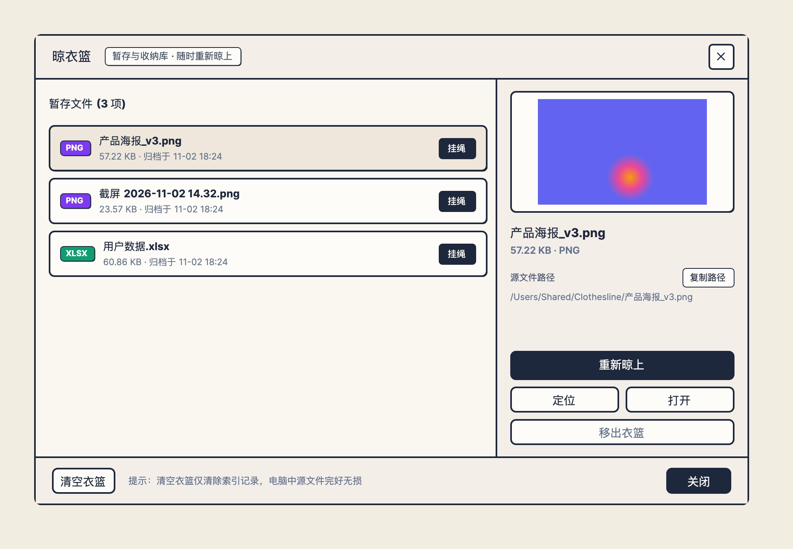

<div align="center">


# 晾衣绳 Clothesline

**一根挂在屏幕顶端的文件中转绳**<br/>
马上要用的文件先挂起来，要用时一伸手就拿走。

[](../../releases/latest)
&nbsp;

&nbsp;




</div>

---

## 你是不是也这样？

- 📸 **截图、下载、聊天里收到的文件**散落在桌面、下载目录和聊天缓存里，要用的时候怎么也找不到；
- 🪟 想把文件从一个软件拖到另一个软件，得先把两个窗口**来回切换、摆好位置**；
- 🗂️ 为了「待会儿要用」，文件先扔到桌面，**桌面越堆越乱**；
- 🔁 别人要一份 PDF 或 PNG，还得**专门找个转换网站**。

## 晾衣绳是怎么帮你的

鼠标碰一下屏幕顶端，晾衣绳就滑下来；移开就收回去，不挡任何窗口。

| | 能做什么 |
|---|---|
| 🧺 **接住** | **截屏**、在资源管理器/访达里**复制文件**、或者把文件**拖到屏幕顶端**，都会自动挂上绳 |
| ✋ **取走** | 把卡片**直接拖进**微信、飞书、邮件、任意文件夹；**单击**复制文件，粘贴就是附件；**右键**复制文件路径 |
| 🔄 **顺手处理** | 右键一键转换常见格式（图片互转、Word/PPT/Excel 转 PDF、视频提取音频…），转好的文件就挂在旁边 |
| 🧼 **收纳** | 用完的卡片丢进右边的晾衣篮，随时找回、一键重新挂上 |

> **放心用：晾衣绳只记住文件在哪，不移动、不复制、也不会删除你的任何文件。**

<div align="center">

</div>

## 下载安装

前往 **[Releases 页面](../../releases/latest)** 下载最新版本：

| 系统 | 下载哪个 | 安装 |
|---|---|---|
| **Windows 10 / 11** | `Clothesline-版本号-win-x64.exe`<br/><sub>ARM 设备选 `win-arm64.exe`</sub> | 下载后双击即可运行，无需安装其他组件 |
| **macOS · Apple 芯片**（M1/M2/M3/M4） | `Clothesline-版本号-macos-arm64.dmg` | 打开 dmg，把「晾衣绳」拖进「应用程序」 |
| **macOS · Intel 芯片** | `Clothesline-版本号-macos-x64.dmg` | 同上 |

<details>
<summary><b>macOS 提示「无法验证开发者」怎么办？</b></summary>

<br/>

目前安装包还没有经过苹果公证，第一次打开会被拦下。放行一次即可，之后正常使用：

1. 双击打开晾衣绳，看到提示后点「完成」；
2. 打开「系统设置 → 隐私与安全性」，在页面下方找到晾衣绳，点「仍要打开」；
3. 再次确认「打开」。

</details>

<details>
<summary><b>Windows 提示「Windows 已保护你的电脑」怎么办？</b></summary>

<br/>

点「更多信息」→「仍要运行」即可。

</details>

## 三步上手

1. **启动**：打开后晾衣绳常驻在后台。Windows 在右下角托盘、macOS 在顶部菜单栏能看到它的图标。
2. **挂上**：截个屏，或者复制一个文件，它就会自己挂上绳；也可以把文件拖到屏幕最上方。
3. **取走**：把鼠标移到屏幕顶端中间，晾衣绳滑下来，把卡片拖到你要用的地方。

## 操作速查

| 操作 | 效果 |
|---|---|
| 鼠标碰屏幕顶端中间 | 晾衣绳滑出；移开后自动收起 |
| 拖着文件靠近屏幕顶端 | 晾衣绳自动滑出，松手即挂上 |
| 截屏 / 复制文件 | 自动挂上晾衣绳（可在托盘菜单中关闭） |
| **单击**卡片 | 复制文件，可直接粘贴到聊天、邮件或文件夹 |
| **双击**卡片 | 用默认程序打开 |
| **拖出**卡片 | 拖进任意软件或文件夹 |
| 鼠标停在卡片上 | 弹出大图 / 文字预览 |
| **右键**卡片 | 格式转换、复制文件路径、在文件夹中定位、另存为、图片标注… |
| 点卡片右上角 × | 取下放进晾衣篮（不会删除文件） |
| 把卡片拖进晾衣篮 | 收纳；晾衣篮窗口打开时也可以直接拖进窗口 |
| 点晾衣篮 | 打开晾衣篮：查看历史、复制路径、重新挂上 |

<details>
<summary><b>各平台的小差异</b></summary>

<br/>

- **macOS**：晾衣绳挂在菜单栏下方；作为菜单栏工具运行，不占 Dock；在每个桌面（Space）都能用，全屏应用里不会出现。
- **视频提取音频**：Windows 使用系统自带能力；macOS 安装 [ffmpeg](https://ffmpeg.org/)（`brew install ffmpeg`）后支持所有格式，未安装时只支持 MP4 / MOV / M4V 提取 WAV。
- **Office 转 PDF**：Windows 装有 Office 时直接调用 Office 导出，效果最好；其他情况使用内置引擎，复杂排版可能会有差异。

</details>

## 常见问题

**会不会删掉我的文件？**
不会。晾衣绳只保存文件的位置。取下卡片、清空晾衣篮都只是删除记录，你电脑里的文件原封不动。只有晾衣绳自己生成的临时文件（截屏、转换结果）会在你移除时清理。

**复制文件就自动挂上，有点打扰？**
在托盘 / 菜单栏图标的菜单里关掉「剪贴板内容自动挂上绳索」即可，截屏和复制的文件会改为直接收进晾衣篮。

**会上传我的文件吗？**
不会。晾衣绳不联网、没有账号，所有记录都只保存在本机。

**会不会挡住我点窗口的关闭按钮？**
不会。晾衣绳收起时鼠标可以直接穿透；Windows 上还会主动避开窗口右上角的最小化 / 关闭按钮区域。

## 它不做什么

晾衣绳只专注「中转」这一件事：**不是**文件管理器（不整理、不移动、不重命名源文件），**不是**剪贴板历史工具（不记文字和链接），**不是**网盘（不联网、不同步），也**不是**专业的转换或修图软件。详见 [产品定位与边界](docs/PRODUCT.md)。

---

## 开发者

基于 .NET 8 与 [Avalonia](https://avaloniaui.net/) 构建，Windows 与 macOS 共用同一套代码。

```bash
dotnet build Clothesline.sln           # 编译
dotnet test Clothesline.sln            # 运行测试
dotnet run --project src/Clothesline.App/Clothesline.App.csproj   # 运行

scripts/package.sh 1.0.0               # 一键打包 Windows exe + macOS dmg（需在 macOS 上运行）
```

推送 `v*` 标签后，GitHub Actions 会自动打包并发布到 Releases（见 `.github/workflows/release.yml`）。

```text
src/
├── Clothesline.App/        界面：晾衣绳、卡片、晾衣篮、预览、转换轮盘
├── Clothesline.Core/       数据模型、本地存储、弹簧物理
├── Clothesline.Engines/    格式转换（图片 / Office / PDF / 音视频 / 数据）
├── Clothesline.Platform/   系统适配（Windows / macOS：剪贴板、鼠标穿透、托盘、开机自启）
└── Clothesline.Tests/      单元测试
```

欢迎提 Issue 和 PR。提新功能前，请先看看 [产品定位与边界](docs/PRODUCT.md)。

## 开源协议

[MIT](LICENSE)
